# GamePulse — Gaming Analytics & Operations Platform

> **This project uses synthetic data created for portfolio purposes and is not affiliated with Garena or Free Fire.**
> Every player, session, match, purchase and country-level difference in this repository is produced by a simulator
> (`backend/seed/simulate.py`). Nothing here is, or claims to be, real telemetry or a real market statistic.

GamePulse is a full-stack analytics and **game-operations** console for a simulated live-service mobile shooter.
It is not a generic BI dashboard: it is built around the question an operator actually gets asked —
*"D7 retention dropped from 31% to 25%. What happened, who is affected, what should we do, and how will we know it worked?"*

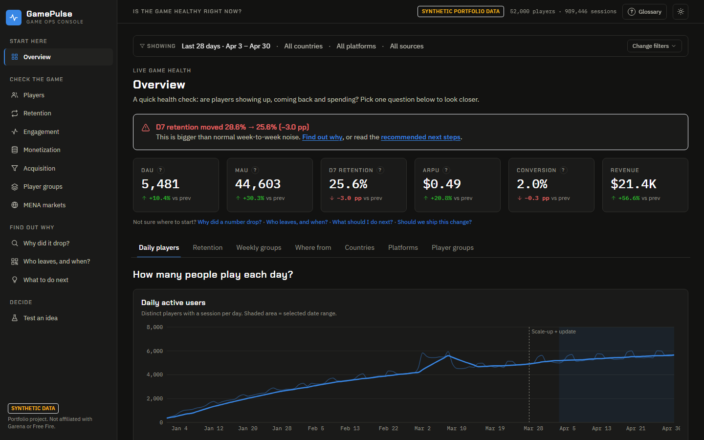

---

## Contents

1. [Business problem](#1-business-problem) · 2. [Objective & workflow](#2-objective--workflow) · 3. [Run it](#3-how-to-run-the-project)
4. [Architecture](#4-architecture) · 5. [Database schema](#5-database-schema) · 6. [Synthetic data](#6-the-synthetic-data-and-its-planted-ground-truth)
7. [KPIs](#7-kpis-and-definitions) · 8. [Analytics methodology](#8-analytics-methodology) · 9. [Segmentation](#9-player-segmentation)
10. [A/B testing](#10-ab-testing) · 11. [Example business case](#11-example-business-case) · 12. [MENA analysis](#12-mena-market-analysis)
13. [API](#13-api-reference) · 14. [Tech stack](#14-technology-stack) · 15. [Screenshots](#15-screenshots) · 16. [Key findings](#16-key-findings) · 17. [Limitations](#17-limitations)

---

## Using the site in 60 seconds

You do not need to know analytics jargon to use GamePulse, and no page shows more than one question at a time.

1. **Start on the Overview.** Six headline numbers answer "is the game healthy?". A red banner appears when retention has dropped noticeably.
2. **Pick one question.** Each page has a few headline numbers and then a row of views, one per question ("Is revenue growing?", "Which sources bring players who stay?"). Only the selected view is shown; *Next view* walks you through the rest.
3. **Investigating a drop?** *Why did it drop?* is a 7-step guided flow (What happened -> Where -> Which group -> What's different -> Device quality -> Possible causes -> What next), starting with an "In plain words" summary.
4. **Don't know a word?** Click the **?** beside a number, or open **Glossary** (top right).
5. **Filters stay out of the way.** One line says what you are looking at; click *Change filters* only when you want to narrow it.
6. **Choices are toggles, not extra charts.** "Group by country / platform / source" is a small switch inside one chart.

---

## Import your own data (no commands)

Open **Import data** in the sidebar and drop in your CSV exports (or one .zip of them). GamePulse does the rest:

1. **Detects** which file is which (by name or by columns) and **matches your column names** automatically (`user_id`, `timestamp`, `Duration (s)`…); you can fix any mapping in a dropdown.
2. **Checks** the data and tells you what is blocking (errors) and what defaults will be used (warnings).
3. **Loads** everything in a single database transaction: if anything fails, your current data is left untouched.
4. **Shows the results**: row counts, date range, which analyses your data supports, and the top automatic findings, then opens the Overview.

Only a **sessions** file is required (a player id and a start time per play session). Players are built from the sessions if you have no players file; string/UUID ids become anonymous numbers; epoch timestamps, `;`/tab separators and durations in seconds are handled. Optional files unlock more pages: purchases (Monetization), matches (game modes), events (tutorial/crash explanations), devices, experiments.

Also on that page: **download sample CSVs**, or **load the demo dataset** (52,000 or 5,000 players) with one click. Set `ALLOW_IMPORT=0` on the backend to disable uploads (e.g. on a public deployment). The terminal route still works: `python -m seed.import_csv --dir <folder>`; it shares the same pipeline.

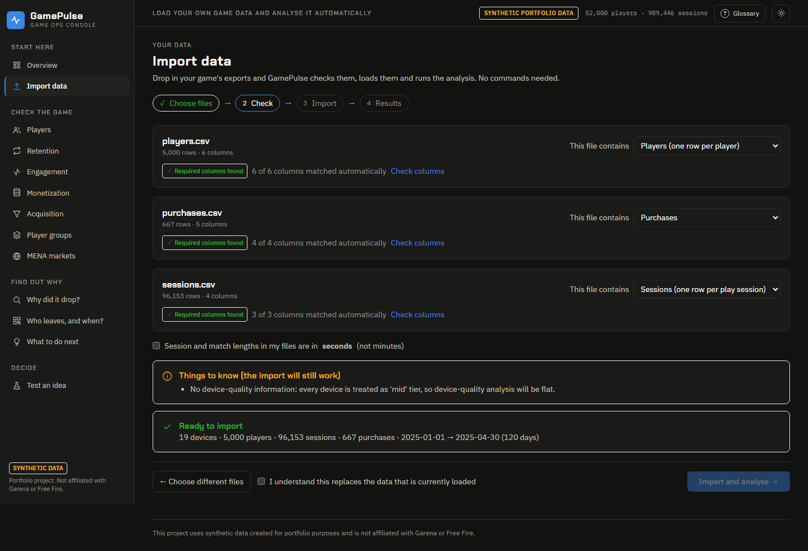
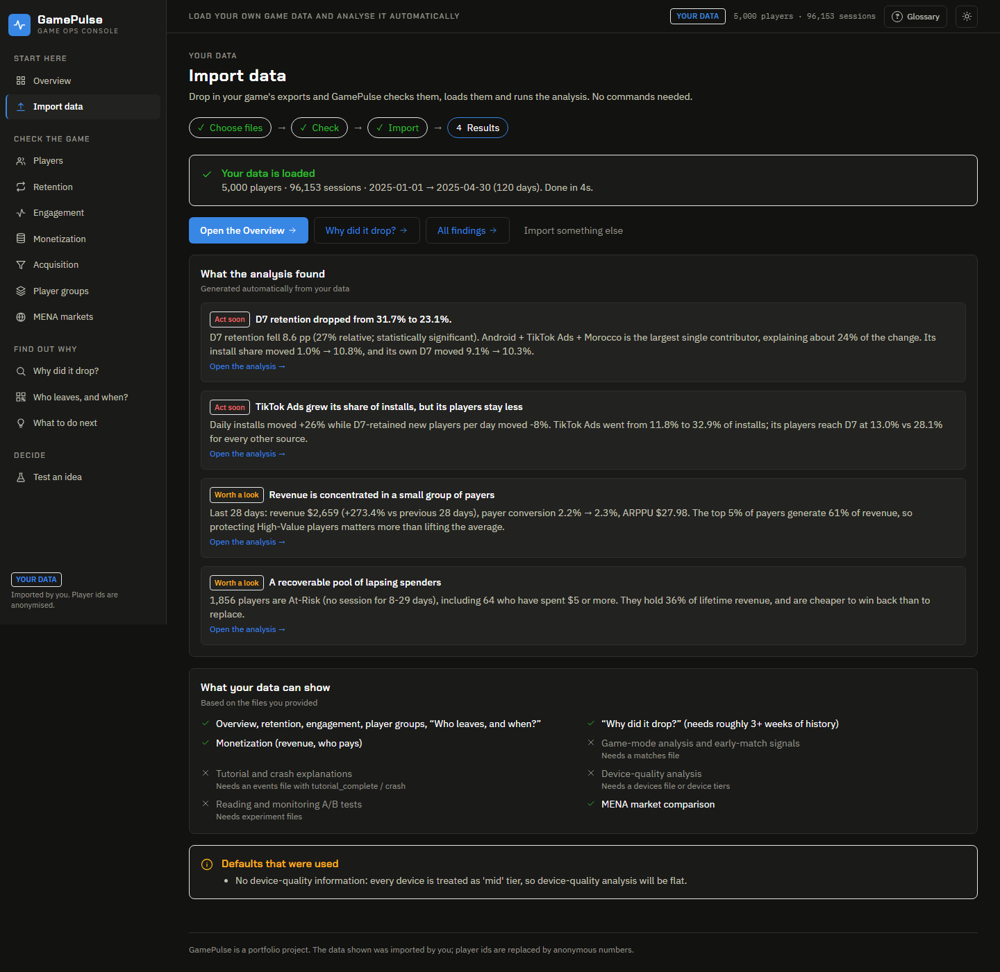

---

## 1. Business problem

A live-service mobile game earns money from a small share of players who stay for weeks. Three things go wrong quietly:

* **Acquisition quality drifts.** Install volume can rise while the number of players who actually stick falls.
* **Technical regressions hide inside averages.** A release that hurts low-end Android devices barely moves a global KPI.
* **Teams jump to causes.** A retention dip is blamed on "matchmaking" or "the new event" with no evidence, and fixes are shipped without measurement.

Game operations and strategy teams need a workflow that localises a problem, separates *evidence* from *explanation*, and
closes the loop with an experiment.

## 2. Objective & workflow

GamePulse demonstrates the full chain, and each step lives on a specific page:

| Step | What happens | Where |
|---|---|---|
| **Business problem** | "D7 retention dropped" is detected and surfaced as an incident | Overview banner, Investigation header |
| **KPI** | Standard definitions for DAU/MAU, D1/D7/D30, ARPU/ARPPU, churn | Overview, Retention, Engagement, Monetization |
| **Data** | 52k players, ~1M sessions, ~1.2M matches in PostgreSQL | [Schema](#5-database-schema) |
| **Segmentation** | Six rule-based lifecycle segments + optional K-Means | Segmentation |
| **Analysis** | Exact contribution decomposition across country × platform × source | Investigation |
| **Hypothesis** | Five candidate causes, each labelled *Hypothesis requiring validation* with data signals | Investigation |
| **Experiment** | Randomised A/B tests analysed with statsmodels | Experiments |
| **Recommendation** | Auto-generated Insight → Evidence → Hypotheses → Next step → KPI to monitor | Operations Insights |
| **Measurement** | Sample-size / power plan for the follow-up test, KPIs and guardrails to watch | Investigation, Insights |

**Pages (sidebar names in brackets):** Overview · Players · Retention · **Retention Explorer** · Engagement · Monetization · Acquisition · Segmentation · MENA markets ·
Investigation [*Why did it drop?*] · Retention Explorer [*Who leaves, and when?*] · Operations Insights [*What to do next*] · Experiment Hub [*Test an idea*] (12 in total). Global filters (date, country, platform, source, game mode, segment) apply to all monitoring pages.

## 3. How to run the project

**Prerequisites:** Docker Desktop (Compose v2). Nothing else is required.

```bash
git clone <this repo> gamepulse && cd gamepulse
docker compose up --build
```

First start takes a few minutes: it builds three images, then a one-shot `seed` job generates the synthetic dataset,
bulk-loads it with `COPY` (~1 min) and builds the derived tables. Subsequent starts skip seeding.

| Service | URL |
|---|---|
| Dashboard | <http://localhost:3000> |
| API docs (Swagger) | <http://localhost:8000/docs> |
| PostgreSQL | `localhost:5432` (user/password/db: `gamepulse`) |

Ports taken? Copy `.env.example` to `.env` and change `WEB_PORT`, `API_PORT`, `DB_PORT`.

**Useful commands**

```bash
docker compose run --rm seed python -m seed.generate --force                 # regenerate everything
docker compose run --rm seed python -m seed.generate --force --players 80000 --seed 7
docker compose run --rm seed python -m seed.generate --derived-only         # rebuild derived tables after editing segment_rules.py (≈15 s)
docker compose run --rm --no-deps backend python -m pytest                   # unit tests (no database needed)
```

**Local development (no containers for the apps)**

```bash
docker compose up -d db
cd backend && python -m venv .venv && . .venv/bin/activate && pip install -r requirements.txt
python -m seed.generate && uvicorn app.main:app --reload --port 8000
cd ../frontend && npm install && API_INTERNAL_URL=http://localhost:8000 npm run dev
```

## 4. Architecture

```
 Browser ──► Next.js 14 (React, TypeScript, Tailwind, Recharts)  :3000
                │   /api/*  (server-side rewrite, no CORS in the browser)
                ▼
            FastAPI  :8000   ── services: metrics · investigation · experiments
                │                          segmentation · mena · insights
                │  SQLAlchemy / pandas.read_sql   (parameterised SQL only)
                ▼
            PostgreSQL 16  :5432
              raw tables ─► derived tables (player_daily_activity, player_daily_mode, player_base)

 seed (one-shot job)  simulate.py ─► COPY ─► db/02_derived.sql
```

Design choices worth knowing:

* **SQL does the aggregation, Python does the reasoning.** Filters compile into two reusable CTEs (`scope` = filtered players,
  `act` = their daily activity). Retention, DAU, revenue and churn all share them, which is why numbers reconcile across pages.
  Python (pandas / statsmodels / scikit-learn) is used where SQL is the wrong tool: decomposition, hypothesis testing, K-Means.
* **A derived layer makes the dashboard fast.** `player_daily_activity` (one row per player-active-day) and `player_base`
  (one denormalised row per player with retention flags, early-engagement counters and segment) turn 1M-row scans into cheap aggregates.
* **Rule parameters live in one file.** `backend/app/segment_rules.py` is injected into the SQL *and* served to the UI, so the documented thresholds are the executed ones.
* **Results are memoised in-process** (the dataset is immutable between seeds).

## 5. Database schema

Raw tables (`db/01_schema.sql`):

| Table | Columns |
|---|---|
| `players` | `player_id` PK, `country`, `platform`, `device` → `devices`, `install_date`, `acquisition_source` |
| `sessions` | `session_id` PK, `player_id` FK, `session_start`, `session_duration_minutes` |
| `matches` | `match_id` PK, `player_id` FK, `match_date`, `game_mode`, `kills`, `placement`, `match_duration_minutes`, `result` |
| `purchases` | `purchase_id` PK, `player_id` FK, `purchase_date`, `amount` (synthetic USD), `item_type` |
| `events` | `event_id` PK, `player_id` FK, `event_name` (`first_open`, `tutorial_*`, `daily_login`, `level_up`, `store_view`, `ad_watched`, `crash`, `liveops_event_join`, `friend_invite`), `event_date` |
| `experiments` | `(experiment_id, player_id)` PK, `variant` (`control`/`test`), `assignment_date` |
| `devices` | `device` PK, `platform`, `device_tier` (`low`/`mid`/`high`) — supports the device-performance analysis |
| `experiment_catalog` | name, hypothesis, primary KPI, arm labels, enrolment window |
| `meta_info` | data window and the synthetic-data label |

Derived tables (`db/02_derived.sql`, rebuilt by the seeder):

| Table | Grain | Purpose |
|---|---|---|
| `player_daily_activity` | player × active day | sessions, minutes, matches, revenue — powers DAU/MAU, retention, revenue |
| `player_daily_mode` | player × day × game mode | mode-level filters and game-mode analytics |
| `player_base` | player | D1/D7/D30 flags (NULL until the player is old enough), early-engagement counters, 14-day revenue, tutorial/crash signals, first-5-match stats, **segment** |

A few SQL techniques worth reading in `02_derived.sql`: `FULL JOIN … USING` to merge three event streams, conditional aggregation with
`FILTER`, `DISTINCT ON` for first-mode, window functions for the first five matches, and `CASE WHEN … THEN … END` retention flags that stay `NULL` for immature cohorts so `AVG()` excludes them automatically.

## 6. The synthetic data and its planted ground truth

52,000 players installing over 120 days (2025-01-01 → 2025-04-30), ≈ 989k sessions, ≈ 1.19M matches, ≈ 989k events and ≈ 7.2k purchases. Ten countries
(the six MENA markets plus Turkey, Brazil, Indonesia, France), two platforms, 19 device models in three tiers, seven acquisition sources, four game modes.

The simulator is **causal, not random**: each player has a latent stickiness built from country, platform, source, device tier and noise;
retention, session length, spend and crash exposure all derive from it, so the analytics finds structure that is genuinely in the data.

**Planted effects** (disclosed here so the demo is honest — the tool never sees this list):

| # | Effect | Where you should discover it |
|---|---|---|
| 1 | From **2025-03-27** a TikTok campaign scale-up sends a large share of installs as low-quality Android traffic, concentrated in Morocco | Investigation → culprit segment *Android + TikTok Ads + Morocco* |
| 2 | Same date: crash rate jumps on **low-end Android** | Investigation → device performance, Insights card |
| 3 | `exp_onboarding_v2`: improved onboarding lifts stickiness for installs 2025-01-31 → 02-26 | Experiments (significant D7 lift) |
| 4 | `exp_store_bundle_v1`: a tiny conversion nudge that is *not* detectable at this sample size | Experiments (correctly "no decision") |
| 5 | Anniversary live-ops event 2025-03-02 → 03-08 lifts DAU and new-player retention | DAU / retention trend bump |
| 6 | Matchmaking and difficulty are **not** changed | Hypotheses show "No supporting signal" — the engine does not confirm everything |

Reproducible: `seed=42`. Row counts are shown in the app header.

## 7. KPIs and definitions

| KPI | Definition |
|---|---|
| New players | Installs with `install_date` in the window |
| DAU | Average number of distinct players with ≥ 1 session per day in the window |
| MAU | Distinct players with ≥ 1 session in the 30 days ending on the end date |
| DAU/MAU | Average DAU over those 30 days ÷ MAU (stickiness) |
| Sessions / matches per player | Totals in the window ÷ active players in the window |
| Avg session duration | Total session minutes ÷ sessions |
| **D1 / D7 / D30 retention** | Share of the install cohort with a session **exactly** N days after install. Only players old enough to reach day N are counted (classic "day-N" definition) |
| Early churn | Share of the cohort with **no** session on days 8–14 |
| Revenue / ARPU / ARPPU / conversion | Revenue; revenue ÷ active players; revenue ÷ paying players; paying ÷ active players (all in-window) |
| Churn rate | Of players installed ≥ 30 days ago, share whose last session is ≥ 30 days old |
| Inactive players | Installed, but no session in the last 14 days |
| Returning players | Active in the last 30 days after a ≥ 14-day gap |
| Churn by player segment | Players active in the prior 30 days but gone in the latest 30, grouped by *prior* engagement (High-Value / Engaged / Casual) |

Cohort metrics (retention, early engagement) use players *installed* in the window; activity metrics use behaviour *inside* it. The filter bar says so.

## 8. Analytics methodology

### Investigation engine (`services/investigation.py`)

1. **Two equal install-cohort windows** (previous / current). The current window ends at the last cohort old enough to measure the KPI.
2. **Exact additive decomposition.** With segment weight *w* (share of installs) and retention *r*, centred on the previous overall rate *R*:

   `contribution_s = w_cur·(r_cur − R) − w_prev·(r_prev − R)`   and   `Σ_s contribution_s = overall change` (verified by a unit test).

   Each contribution splits into a **rate effect** `avg(w)·(r_cur − r_prev)` (players behave differently) and a **mix effect**
   `(w_cur − w_prev)·(avg(r) − R)` (a different kind of player arrives). This is what stops the tool from blaming a segment that merely grew or shrank.
3. **Search** every country × platform × source combination (140), rank by contribution, require ≥ 40 players in the current window.
4. **Profile** the winner: D7, D1, sessions/player, session duration, matches/player, early churn, tutorial completion, crashes per 100 sessions, payer rate — each with direction (better/worse).
5. **Significance** of the overall and segment changes via a two-proportion z-test (statsmodels).

### Hypothesis generation — and its guardrails

For the profiled segment the engine evaluates five candidate causes (acquisition quality, onboarding, device performance, matchmaking, new-player difficulty).
Each one is computed from data **signals** (e.g. install-share change and D1 gap; tutorial completion; crashes **per 100 sessions**, normalised for exposure because players who churn early have fewer chances to crash; first-5-match win rate and placement), and is returned as:

* a permanent label: **"Hypothesis requiring validation"**,
* a signal strength: *Data consistent* · *Weak signal* · *No supporting signal* · *Insufficient data*,
* a concrete **validation step** — and, where the dataset lacks the evidence (queue times, ad spend), it says so rather than guessing.

### Cohort & Retention Explorer

A dedicated workspace for the question *which players are leaving, when, and which cohort changed?* (`services/explorer.py`, page `/explorer`).
Everything can be grouped by **install week, country, platform, acquisition source, first game mode, device tier, tutorial completion or player type (segment)**:

* **Cohort heatmap** — D1…D60 retention per cohort, with an "All players" reference row.
* **Retention curves** — day-by-day D0→D30 per group, plus *lost after day 0*, D7/D14/D30 and the **steepest relative drop after day 1**.
* **When do players leave?** — the day each player's **first break of 7+ days** began. (A first version used "last session ever", but sporadic returners pushed 86% of players into the last bucket and hid the signal; the first-break definition separates early leavers — e.g. 14% of TikTok installs break right after day 0 vs 5% of Referral — from slow decayers.)
* **Period-over-period** — two equal install-cohort windows per metric (D1/D7/D30). For every group: installs, install-share shift, retention before/after, change, **95% interval, two-proportion z-test p-value**, and a contribution to the overall change that sums exactly to it (same centred decomposition as the Investigation). Groups under 30 players are flagged.

Notes baked into the UI: retention-by-segment is descriptive only (the segment is defined partly by recent activity, so "Churned" always looks worst); with many cohorts a few "significant" rows are expected by chance.

## 9. Player segmentation

Rules are evaluated top-to-bottom; the first match wins (`backend/app/segment_rules.py`):

| # | Segment | Rule |
|---|---|---|
| 1 | New Players | Installed ≤ 7 days ago |
| 2 | Churned Players | No session for ≥ 30 days |
| 3 | At-Risk Players | No session for 8–29 days |
| 4 | High-Value Players | Active in the last 7 days **and** lifetime spend ≥ $10 |
| 5 | Engaged Players | Active in the last 7 days **and** active on ≥ 4 of the last 14 days |
| 6 | Casual Players | Everyone else who is still active |

**K-Means (optional).** Log-scaled, standardised features (sessions, minutes and matches over 30 days, lifetime spend, recency, tenure), k selectable 4–7,
with an elbow chart, silhouette score, PCA scatter, and a table showing how clusters overlap the rule-based segments. Rules are what the business acts on (explainable, stable);
K-Means is a cross-check for groupings the rules might miss.

## 10. A/B testing and the Experiment Hub

The Experiment Hub (`/experiments`) covers the whole life of a test in three tabs:

| Tab | Question | What it does |
|---|---|---|
| **Plan a test** | How many players, how long, and what will we agree before launch? | Sample size, enrolment days, readout day and "what could a 4-week test detect?" from baseline, target lift, power, alpha, arms and daily traffic. Multi-arm tests split alpha. Produces a **measurement plan** (primary KPI, guardrails, checkpoints, stop rules, ship rule) you can copy as text. The Investigation page links here with the segment's baseline and traffic prefilled. |
| **Monitor** | Is a running test healthy, and is an early result trustworthy? | Cumulative lift with a 95% interval for every enrolment day, enrolment balance and a sample-ratio check over time, a **peeking** check (how often did significance flip, and how little data was in when it first looked significant?), and a **novelty** check that compares *relative* lift on days 1-3 vs 10-14 (absolute lift always shrinks as retention decays, so it is not used). |
| **Read results** | Should we ship? | The full readout below, plus the effect inside platform / country / source subgroups with Holm correction across the groups shown. |

Sample-size maths lives in one module (`services/power.py`) so the Investigation and the planner always quote the same number (tested).

### Statistics used in the readout

`services/experiments.py` uses **statsmodels** throughout:

* **Proportion KPIs** (D1, D7, 14-day conversion): `proportions_ztest` + Newcombe CI (`confint_proportions_2indep`).
* **Continuous KPIs** (sessions, matches, revenue per player): Welch t-test + CI (`CompareMeans`).
* **Sample-ratio mismatch** check (χ² against 50/50) — a failed SRM blocks any recommendation.
* **Holm correction** (`multipletests`) on secondary KPIs, so five metrics do not give five chances at a false win.
* **Minimum detectable effect** (`NormalIndPower`, 80% power) so "not significant" is read as *unknown below X*, not *no effect*.
* **Guardrails**: a significant primary win is downgraded to "hold" if a guardrail KPI significantly regresses.
* Outcomes use **fixed post-install windows** (7 days engagement/retention, 14 days monetisation) so both arms are compared like-for-like.

Each result shows control/test sample size, control/test KPI, absolute and relative difference, 95% CI, p-value, significance and a plain-language recommendation.

## 11. Example business case

**"D7 retention dropped from 31.6% to 25.2%."** (installs 2025-02-27→03-26 vs 03-27→04-23; −6.4 pp, −20% relative, p < 0.0001)

1. *Where?* Dimension by dimension the largest drags are Morocco, Android (D7 30.5% → 23.3% vs iOS 35.2% → 33.1%), TikTok Ads and low-end devices (28.4% → 19.1%); every game mode drops by a similar amount, so the problem is not mode-specific.
2. *Which segment?* **Android + TikTok Ads + Morocco** — D7 **23.6% → 10.5%**, its install share **1.5% → 9.7%**, ≈ **30%** of the total change (−1.93 pp). Egypt and Algeria TikTok-Android add ≈ 13% and 11%.
3. *Profile:* sessions/player 6.1 → 3.2, session length 19 → 10 min, matches/player 6.8 → 1.7, early churn 29% → 56%, tutorial completion 62% → 30%.
4. *Hypotheses:* acquisition quality and onboarding → **data consistent**; Android performance → weak for the segment but **clear on low-end devices overall** (crashes per 100 sessions 2.1 → 5.4); matchmaking and difficulty → **no supporting signal**.
5. *Recommendation:* run an onboarding A/B test on the affected segment (≈ 704 players per arm for a 5 pp lift ≈ 27 days), re-target or cap the weakest TikTok campaigns, and ask engineering for crash-free sessions by version × device.
6. *Measurement:* the existing onboarding experiment already shows **+4.9 pp D7 (95% CI 3.1–6.7, p < 0.0001)** → staged rollout starting with the affected segment; monitor D7 with D1, tutorial completion, conversion and crash-free sessions as guardrails.

## 12. MENA market analysis

The MENA page compares Morocco, Saudi Arabia, UAE, Egypt, Algeria and Tunisia on retention, engagement, monetization, acquisition-source mix, platform mix and
segment mix, with every metric **indexed to the MENA average (100)** and a ▲/▼ marker beyond ±5%. Early churn is treated as lower-is-better.
Uses at least a 90-day window so D30 is measurable. **All country differences are parameters of the simulator, not statements about real markets** — the page demonstrates the comparison framework.

## 13. API reference

All `GET`, JSON. Filter params on monitoring endpoints: `date_from`, `date_to`, `country`, `platform`, `source` (repeatable), `game_mode`, `segment`.

| Endpoint | Returns |
|---|---|
| `/api/meta` | data window, filter options, row counts, ops-calendar annotation |
| `/api/kpis` | current vs previous-period KPI set |
| `/api/trends/daily`, `/api/trends/retention` | DAU/MAU/revenue and D1/D7/D30 series (full history) |
| `/api/retention/cohorts` | weekly cohort × day-N matrix |
| `/api/breakdown?dim=` | every headline metric by `country│platform│source│device│device_tier│segment│first_game_mode` |
| `/api/explorer/cohorts`, `/curves`, `/exit-timing`, `/compare` | [Cohort & Retention Explorer](#cohort--retention-explorer) |
| `/api/engagement/modes`, `/api/monetization/summary`, `/api/acquisition/weekly`, `/api/churn`, `/api/players/summary` | page-specific data |
| `/api/segments`, `/api/segments/kmeans?k=` | rules, distribution, mix; clustering |
| `/api/investigation?metric=&window=&country=&platform=&source=` | full case file |
| `/api/insights` | generated insight cards |
| `/api/experiments`, `/api/experiments/{id}` | catalogue; statistical analysis incl. subgroup effects |
| `/api/experiments/plan?kpi=&baseline=&lift_pp=&daily=&power=&alpha=&arms=` | sample size, duration, measurement plan |
| `/api/experiments/{id}/timeline` | cumulative lift, sample balance, peeking and novelty checks |
| `/api/mena` | indexed scorecard + composition |

Interactive docs at `/docs`.

## 14. Technology stack

**Frontend** Next.js 14 (App Router) · React 18 · TypeScript (strict) · Tailwind CSS · Recharts · SWR  
**Backend** Python 3.11 · FastAPI · pandas · NumPy · **statsmodels** · SciPy · scikit-learn · SQLAlchemy  
**Database** PostgreSQL 16, hand-written SQL  
**Infrastructure** Docker / Docker Compose (db → seed job → backend → frontend)  
**Quality** pytest unit tests (51, including the import pipeline: decomposition additivity, explorer comparison and significance, A/B decision logic, power maths, simulator invariants); validated colour-blind-safe chart palette; light/dark themes; keyboard-visible focus; loading / error / empty states on every panel.

```
db/                 01_schema.sql, 02_derived.sql
backend/app/        main.py, filters.py (filter → SQL CTEs), segment_rules.py, routers/, services/
backend/seed/       simulate.py (causal simulator), generate.py (loader)
backend/tests/      pytest suite
frontend/src/       app/ (11 pages), components/ (charts, panels, shell), lib/
```

## 15. Screenshots

| | |
|---|---|
| 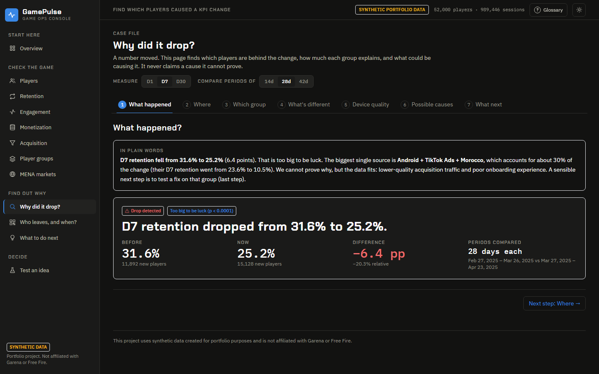 | 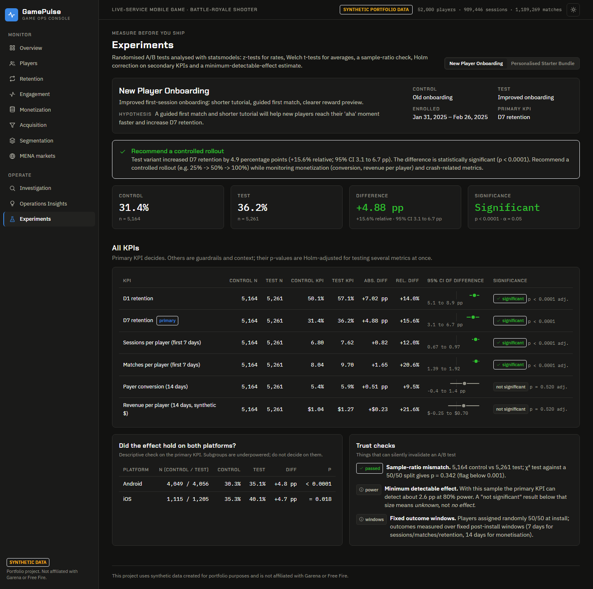 |
| **Investigation** — incident → dimension scan → culprit segment → hypotheses | **Experiments** — significance, CIs, SRM and power |
| 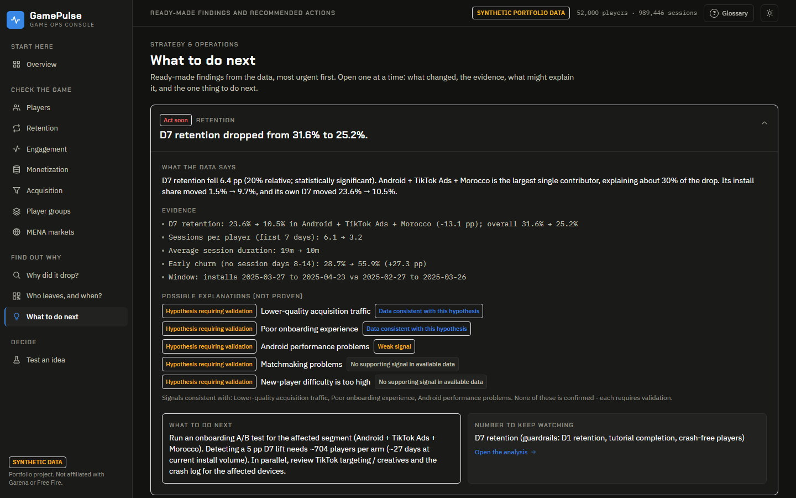 | 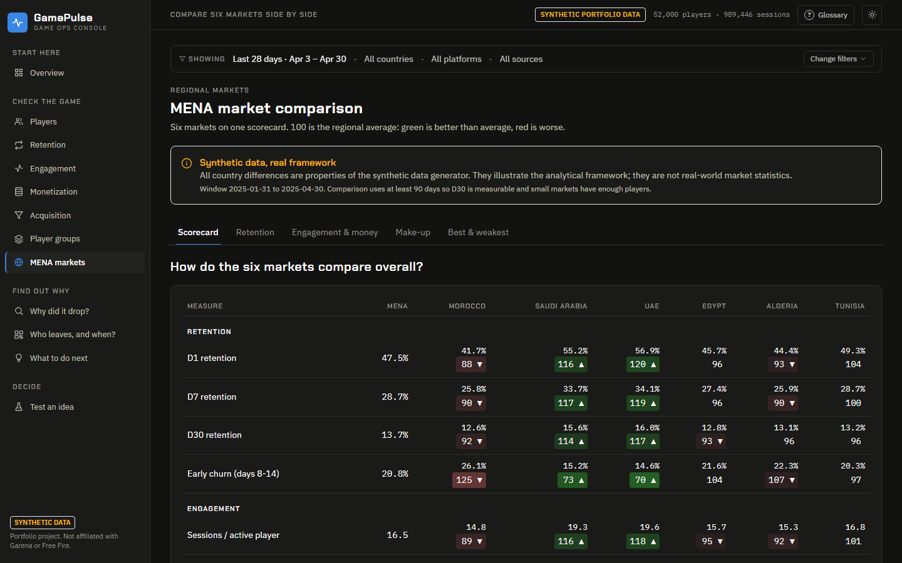 |
| **Operations Insights** — Data → Insight → Hypothesis → Action | **MENA** — indexed market scorecard |
| 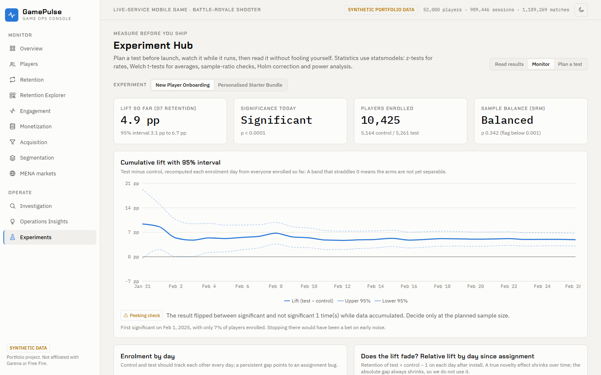 | 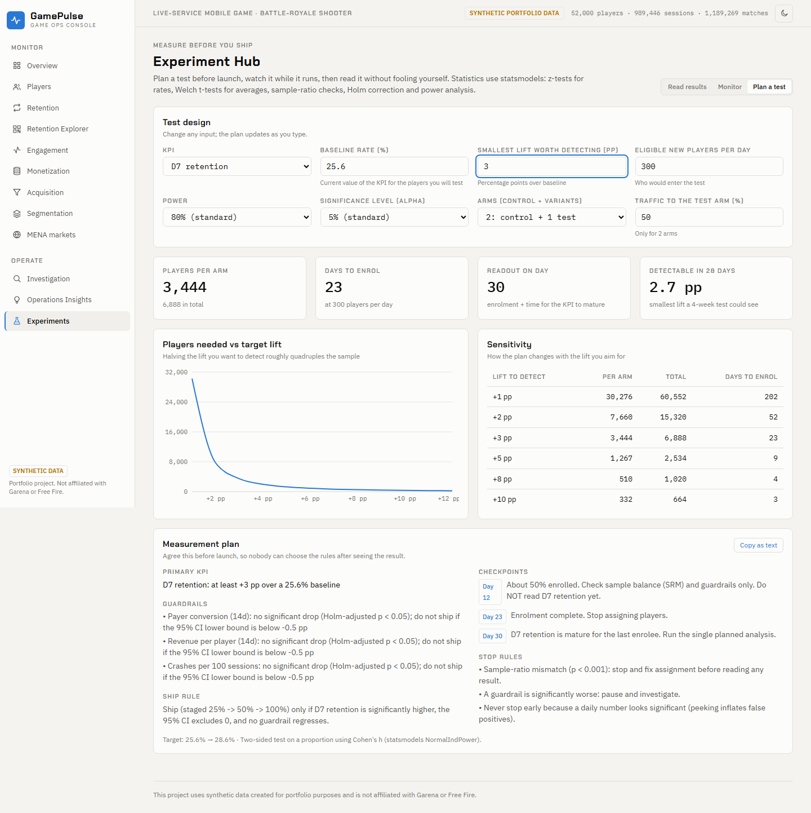 |
| **Experiment Hub: Monitor** - lift over time, peeking and novelty checks | **Experiment Hub: Plan a test** - sample size and measurement plan |
| 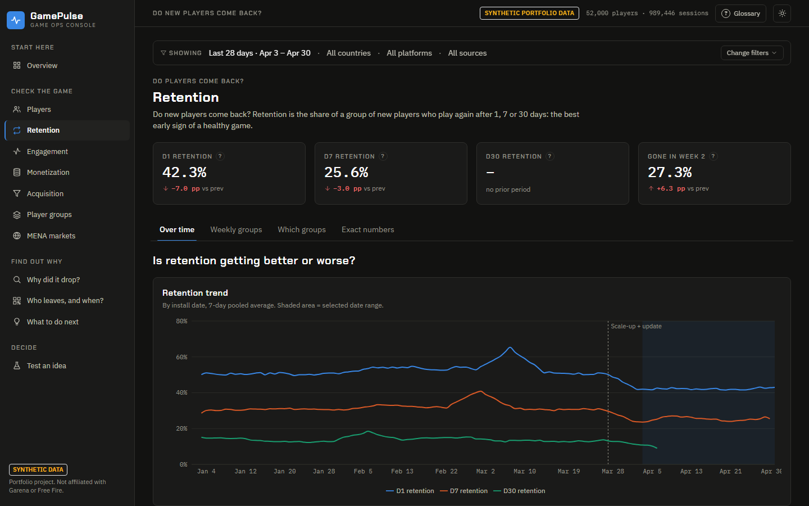 | 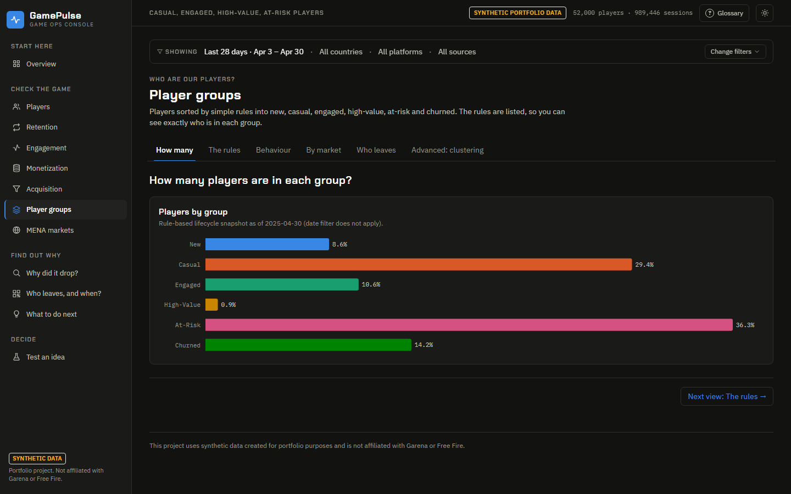 |
| **Retention** — trends, cohorts, breakdowns | **Segmentation** — rules, mix and K-Means |

Cohort & Retention Explorer: 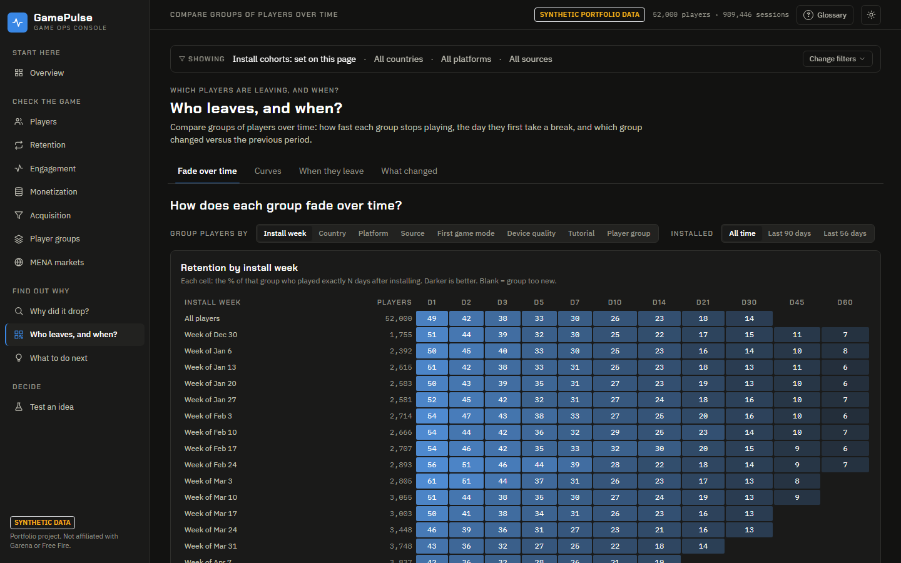

Light theme: 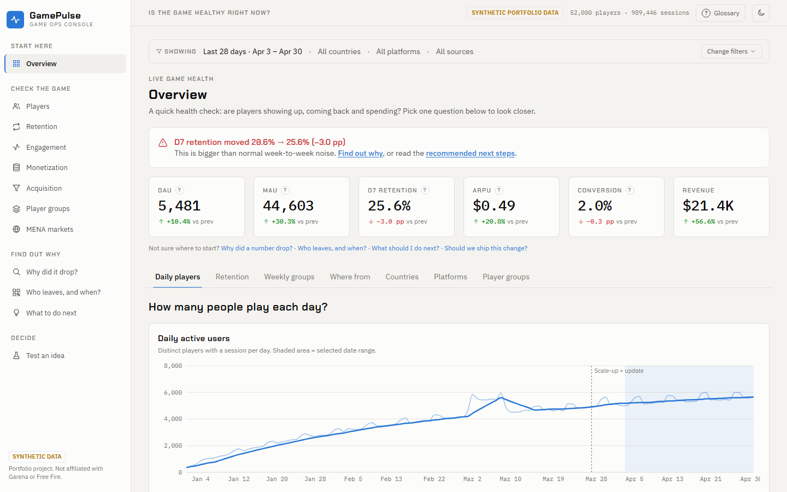

## 16. Key findings

*(from the synthetic dataset — illustrative of what the platform surfaces)*

* **Quality, not volume.** Daily installs grew ≈ 27% after the scale-up while D7-retained new players per day grew ≈ 1%.
* **One segment, a third of the problem.** Android + TikTok + Morocco explains ≈ 30% of the D7 drop; two sibling TikTok-Android markets add another ≈ 24%.
* **A platform-wide technical regression is hiding underneath.** Low-end Android crashes per 100 sessions rose ≈ 2.5×, while high-end devices stayed flat.
* **Onboarding is a proven lever.** The improved flow lifted D7 by ≈ 4.9 pp (+15.6% relative), sessions by 12% and matches by 21%, with no significant change in conversion or revenue.
* **Not every idea is a win.** The personalised starter bundle is statistically indistinguishable from control; the platform says "no decision" and reports the effect size it *could* have detected (≈ 1.7 pp).
* **Revenue is top-heavy.** The top 5% of payers generate roughly half of revenue; At-Risk players still hold about a third of lifetime revenue, a recoverable pool.
* **Markets need different levers.** In the synthetic MENA set, Gulf markets lead on retention and ARPU while North African markets over-index on installs but trail on conversion — different problems, different playbooks.

## 17. Limitations

* **Synthetic data.** Effects are planted by construction; the project demonstrates method and workflow, not discoveries about any real game or market.
* **No marketing spend, crash logs, matchmaking logs or app versions.** CPI/ROAS are deliberately not computed, and two hypotheses explicitly state which logs would be needed.
* **Single observation window (120 days).** D30 is only available for older cohorts; seasonality cannot be assessed.
* **Day-N (exact day) retention** is stricter than "returned on or after day N" and is not directly comparable to other studios' definitions.
* **Hypothesis signals are heuristics** with fixed thresholds; they indicate consistency with the data, never causation. Only the randomised experiments support causal language.
* **Subgroup and segment results are descriptive**; they are not multiplicity-corrected beyond the secondary-KPI Holm correction.
* **One game, one currency (synthetic USD), UTC timestamps**, no regional pricing, no fraud/bot modelling.
* **In-process caching** assumes immutable data; re-seed → restart the API.
* The auto-generated K-Means cluster names are heuristic labels from centroids.

---

*This project uses synthetic data created for portfolio purposes and is not affiliated with Garena or Free Fire.*
